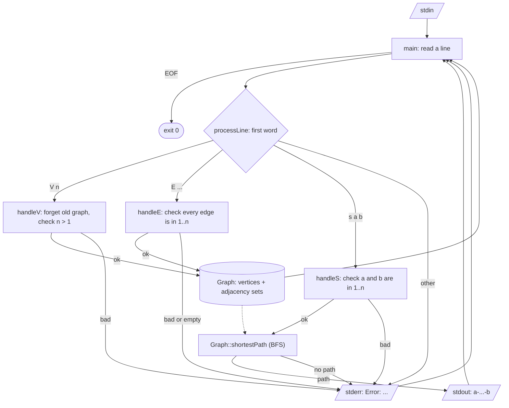

# ECE 650 Assignment 2: Shortest Paths

`ece650-a2` reads an undirected graph and shortest-path queries from standard input and keeps answering until it reaches EOF. There are three commands:

- `V n` starts a new graph with vertices `1` to `n` (`n` has to be more than 1). Anything from the previous graph is forgotten.
- `E {<a,b>,...}` gives the edges for that graph.
- `s a b` prints a shortest path from `a` to `b`, like `2-8-10`.

Paths are printed on stdout. Errors are printed on stderr as one line starting with `Error:`, right after the command that caused them, and the program then carries on. There are no prompts, and it exits with status 0 at EOF.

## Files

| File | What it is |
| --- | --- |
| `ece650-a2.cpp` | The program: the `Graph` class, the command handlers and `main` |
| `test.cpp` | doctest unit tests for the program |
| `doctest.h` | The doctest single-header test framework |
| `CMakeLists.txt` | Builds `ece650-a2` and `tests` |
| `user.yml` | My name, WatIAM, student number and email |

## Building and running

From the top of the repository:

```bash
cd a2 && mkdir build && cd build && cmake ../ && make
```

This builds two programs in `a2/build`: `ece650-a2` itself, and `tests`, which runs the unit tests. To build with AddressSanitizer, add `-DWITH_ASAN=ON` to the `cmake` command.

Example run (input lines start with `V`, `E` or `s`):

```
$ ./ece650-a2
V 6
E {<1,2>,<2,3>,<4,5>}
s 1 3
1-2-3
s 3 5
Error: no path exists between 3 and 5
s 6 6
6
```

You can also pipe a file in with `./ece650-a2 < input.txt`.

## Design

The program is in one file, split into two parts.

The `Graph` class at the top stores the number of vertices and an adjacency list, and has `shortestPath(a, b)`, which runs a breadth-first search. It doesn't print anything. It just returns the path, or an empty vector if there isn't one.

Below it are the command handlers. `main` reads a line at a time and passes it to `processLine`, which calls `handleV`, `handleE` or `handleS` depending on the first word. Each handler checks its arguments against the current graph, updates or queries the graph, and prints either the result or an error. All the error messages go through `reportError`, so they all have the `Error:` prefix and are flushed straight away.

The handlers write to stream parameters instead of `std::cout`/`std::cerr` directly. `main` passes in the real streams, and `test.cpp` passes in string streams so it can check exactly what was printed.



### Shortest path

Every edge counts as length 1, so a path with the least number of edges is a shortest one, and BFS finds it in O(V + E). BFS keeps a `parent` map that records where each vertex was reached from. As soon as the target is discovered the search stops, and the path is rebuilt by following `parent` back to the start and reversing it. If the start and target are the same vertex, that single vertex is returned straight away, as the clarifications say.

## Design decisions

- **BFS rather than Dijkstra or Bellman-Ford.** The graph is unweighted, so BFS gives the same answer and is simpler and faster.
- **Adjacency stored as `unordered_map<vertex, unordered_set<vertex>>`.** Only vertices that have edges take up space, so a large `V` with few edges is cheap and I didn't need to cap `V`. The sets also make duplicate edges (`<1,2>` twice, or `<1,2>` and `<2,1>`) count as one edge.
- **An `E` with a bad endpoint is rejected completely.** If any endpoint is outside `1..n` (including 0 and negative numbers), none of the edges are kept. Keeping only the valid ones would give paths for a graph the user never actually typed.
- **`E {}` is reported as an error but the vertices are kept**, so `s v v` still works afterwards. The clarifications say an empty edge set should ideally be an error.
- **Self-loops are skipped**, since going from a vertex back to itself never makes a path shorter.
- **A new `V` clears the old graph before checking `n`.** So after something like `V 1`, later `E` and `s` commands give an error instead of quietly using the previous graph.
- **Vertex IDs are read as `long long`.** If `-1` were read as `unsigned` it would wrap around to a huge number. Numbers too big even for `long long` are caught and reported instead of crashing.
- **When there's more than one shortest path, any of them can be printed.** Which one comes out depends on the order of the hash sets, so it could differ between compilers, but the handout allows any shortest path.

## Challenges

The main one was a bug that was easy to miss. My first version read the edge list with `>>`, which stops at the first space. The spec says there are no spaces inside the braces, but if one did show up, as in `E {<1,2>, <2,3>,<3,4>}`, only `<1,2>` was kept and the rest were silently dropped. A query that expected "no path" still looked right, so I only noticed when I asked for a path that should have existed. Reading the rest of the line with `getline` fixed it, and there's now a unit test for it.

The other challenge was that the handout only lists three kinds of errors (bad edge vertex, bad query vertex, no path). For cases like `V 1`, `E {}`, self-loops and duplicate edges I followed the clarifications page. Where it left the choice up to us, I picked the behaviour that never leaves a half-built graph around.

## Testing

`./tests` (in `a2/build`) runs 19 doctest test cases covering:

- normal paths, including ones that go the short way round a ring
- the errors named in the handout: an edge to a missing vertex, a query on a missing vertex, and no path
- the sample run from the handout
- every case on the clarifications page: `s v v`, isolated vertices, vertices outside `1..V`, `V 0`/`V 1`, `E {}`, self-loops, duplicate edges, a new `V` after an error
- a few extra ones: numbers too large for `long long`, unknown commands, a last line with no newline, a very large `V`

For errors the tests only check the `Error:` prefix and how many error lines there are, since that's all the spec fixes. For the handout sample, either shortest path is accepted.

Apart from the unit tests, I also piped all of these inputs into the built `ece650-a2` and compared stdout and stderr. I also ran everything again with AddressSanitizer and UndefinedBehaviorSanitizer (`-DWITH_ASAN=ON`), and tried a 100,000-vertex chain (about 0.2 seconds) and input with Windows line endings. Everything passed.

Some example results:

| Input | stdout | stderr |
| --- | --- | --- |
| `V 7`, `E {<1,2>,<2,3>,<3,6>,<1,4>,<4,5>,<6,7>}`, `s 1 7` | `1-2-3-6-7` | |
| `V 4`, `E {<1,2>,<2,7>}` | | `Error: edge <2,7> references a vertex outside 1..4` |
| `V 6`, `E {<1,2>,<2,3>,<4,5>,<5,6>}`, `s 1 6` | | `Error: no path exists between 1 and 6` |
| `V 3`, `E {}`, `s 2 2` | `2` | `Error: empty edge set` |
| `V 1`, `V 2`, `E {<1,2>}`, `s 1 2` | `1-2` | `Error: number of vertices must be greater than one` |
| `V 3`, `E {<1,2>,<2,3>}`, `s -1 2` | | `Error: vertex does not exist in the graph (valid range 1..3)` |
